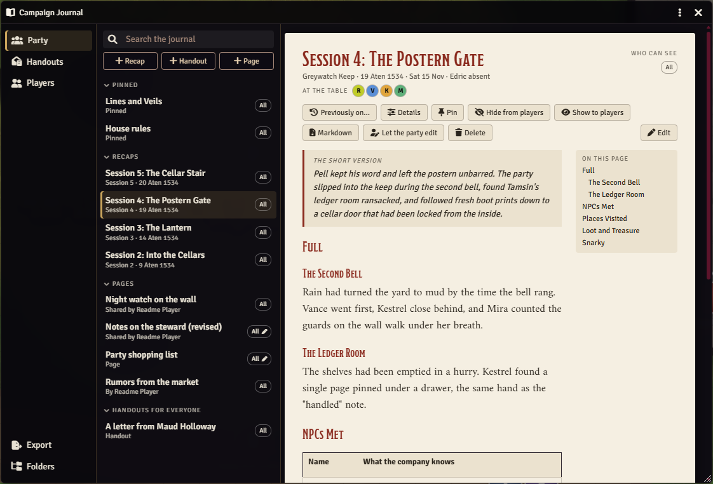
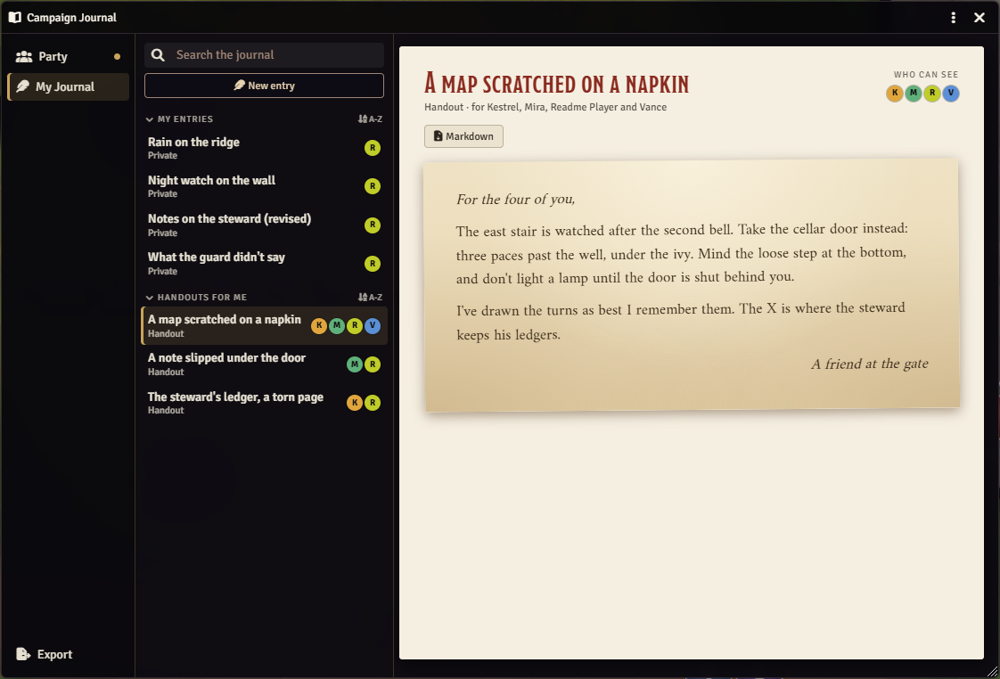
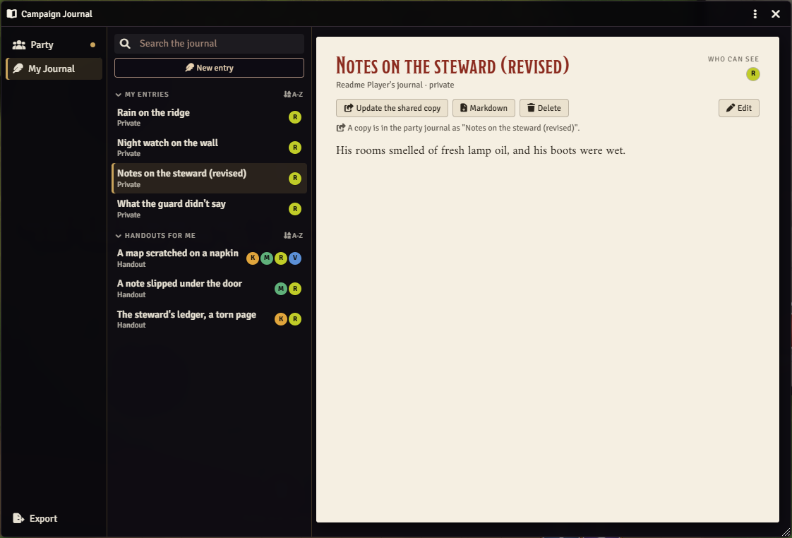
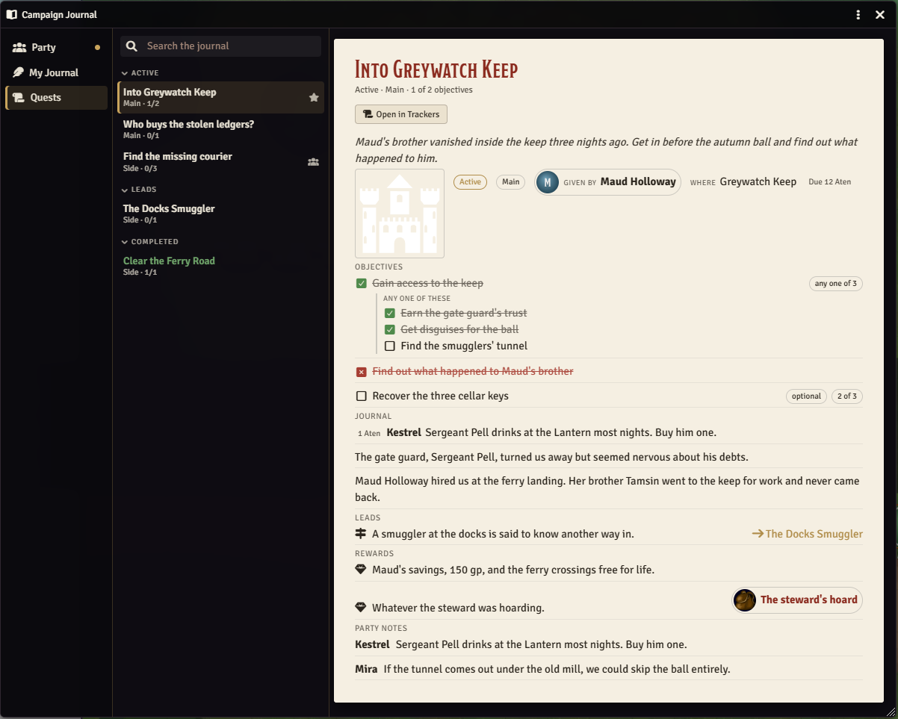
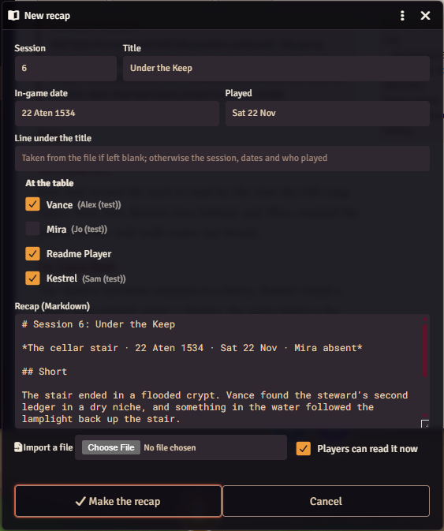
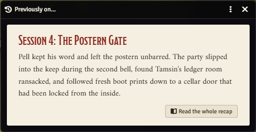

# Bayard's Campaign Journal

A journal window for the party, for Foundry VTT 14 and any game system. It keeps the party journal (session recaps and standing pages such as house rules), handouts for one player or several, and each player's private journal in one place, with search, a table of contents, notices for new things and Markdown export. With PF2e Campaign Trackers installed, the party's quests are there too. Everything is an ordinary Foundry journal entry in a "Campaign Journal" folder, so nothing is lost if the module is turned off.

## What it looks like



**The party journal.** A session recap with its short version in a box, who was at the table, and a table of contents from its headings. Pinned entries lead the list; the dots show who can see each entry.



**A handout.** Handouts show on parchment. This one was given to four players; a player sees only the handouts given to them.



**A player's journal.** Private to the player and the GM, newest first. A player can share a copy to the party journal, and the copy stays theirs to edit.



**The Quests tab.** With PF2e Campaign Trackers installed, the party's quests by status, read in the journal as the players see them, with a button to open the quest in Trackers.



**A new recap.** Paste or import a Markdown recap; the session, title, dates and who was absent fill themselves in.



**"Previously on…".** A recap's short version on the players' screens (and the GM's), with a button to read the rest.

## Install

In Foundry, go to **Add-on Modules**, then **Install Module**, and paste this into **Manifest URL**:

```
https://github.com/Sir-Bayard/bayards-campaign-journal/releases/latest/download/module.json
```

Foundry's **Update** button then picks up each new release. You can also download `module.zip` from the [latest release](https://github.com/Sir-Bayard/bayards-campaign-journal/releases/latest) and unzip it into `Data/modules/bayards-campaign-journal`.

Requires Foundry VTT 14 (verified on 14.369). It works with any game system.

## Opening it

Click **Campaign Journal** at the top of the Journal tab, or press **J** (change it in **Configure Controls**). The window remembers its size and place in each browser.

## Where things live

When a GM first logs in with the module on, it makes a **Campaign Journal** folder in the Journal tab with three folders inside:

- **Party**: the party journal. Recaps, standing pages, players' party entries and shared copies.
- **Handouts**: one entry per handout. Who has a handout is simply who can see it.
- **Players**: a folder for each player, holding their journal. Players who join later get one too, and a folder follows its player's name.

The module finds these folders by a mark it puts on them, not by their names, so you can rename them. Entries you move into them by hand join the journal; entries you move out leave it. Players don't see the folder in their Journal tab (they read everything in the window); the setting "Players see the journal's folder" shows it again.

## The window

- **Tabs.** Players see **Party** and **My Journal**. The GM sees **Party**, **Handouts** and **Players** (every player's journal and the handouts only some players have). With PF2e Campaign Trackers, everyone also has **Quests** (see [Quests](#quests)).
- **Who can see.** The dots beside an entry are the players who can read it, in their colors with their character's initial; **All** means every player, including players who join later, and a small pen means the party can edit it. **GM** means only GMs can.
- **Fold** any group (Recaps, Pages, Handouts and the rest) by clicking its heading, so thirty recaps don't push the pages out of sight. Folded groups show a count and stay folded in that browser.
- **Search** looks through titles and page text, including folded groups.
- **On this page** lists a long page's headings; click one to jump to it.
- **New and Updated** marks show players what they haven't opened since it arrived or changed, with a dot on the tab. A short notice says when something new reaches them: a recap, a handout given to them, a shared or party entry. Edits show as Updated without a notice, and a player's own changes never mark anything.
- **Markdown** downloads an entry; **Export** at the bottom of the tabs downloads the whole tab as one Markdown file.
- **Folders** (GM) opens the journal's folders in the Journal tab.

## For the GM

The buttons over the list make new entries: **+ Recap**, **+ Handout** and **+ Page**.

**Recaps.** Paste a recap or import a Markdown file. A recap laid out like this fills the form in:

```markdown
# Session 4: The Postern Gate

*Greywatch Keep · 19 March 1200 · Sat 15 Nov · Edric absent*

## Short

The party talked its way past the gate and found the cellar stair.

## Full

...
```

The heading gives the session number and title; the italic line gives the in-game date (read with the world's calendar), the real date, and anyone marked absent, who are unticked under "At the table". The **Short** section becomes the short version, in a box at the top. The rest is the recap itself, kept as Markdown would show it, tables included. Left empty, a recap starts from a template to write in. **Details** changes a recap's session, dates, line under the title and who was there.

Recaps list newest session first. **"Previously on…"** shows a recap's short version on the screens of the players who can read it, with a button to read the whole recap. It shows on your screen too, so you see what they see, even with no player logged in.

**Handouts.** **+ Handout** starts from a letter layout (or a blank page) on parchment, for everyone or for players you choose. **Give to…** changes who has it later. A handout for everyone shows on the Party tab; one for some players shows on their My Journal tab.

**Pages.** **+ Page** makes a standing page in the party journal, such as house rules or a lines and veils list, pinned or not, readable by players now or later, and editable by the whole party if you like.

**Pinned.** **Pin** keeps anything on the Party tab at the top: pages, recaps, shared copies, handouts for everyone. Drag pinned entries up and down to put them in order; a new pin goes to the bottom.

**Also:** **Hide from players** and **Let players read it** switch a party entry between GM-only and readable by every player. **Show to players** opens an entry on the screens of the players who can read it. **Let the party edit** lets every player edit a party page and add to it. **Delete** removes any entry. **Edit** opens Foundry's editor; on a one-page entry, renaming the page renames the entry. Foundry's secret blocks work as usual: players don't see them in the window, and they stay out of players' downloads, search and "Previously on…".

## For players

**My Journal** holds your own entries, which only you and the GM can read, and the handouts given to you. Each list has its own toggle between newest first and A to Z (A to Z files titles library-style: a leading "A", "An" or "The" is ignored, and numbers sort in order).

- **New entry** makes an entry and opens it in Foundry's editor. Rename it there and the entry follows.
- **Share a copy to the Party Journal** puts a copy in the party journal, signed with your name. Everyone can read it, you can still edit the copy, and your own entry stays private. Sharing the same entry again replaces the copy (after asking), including anything others added to it.
- **New party entry** (on the Party tab) writes straight into the party journal, signed with your name.
- **Let the party edit** on your party entry or shared copy lets every player edit it and add to it; you can stop it again. Only you and the GM can delete it.
- **Delete** removes your own entries, shared copies and party entries.

If players may create journal entries (Foundry's **Create New Journal Entries** permission), all of this works with no GM logged in. Without that permission the GM's client makes the entries for them, so a GM must be logged in. Changing who can edit an existing entry always needs a GM logged in, since Foundry lets only GMs change permissions.

## Quests

With [PF2e Campaign Trackers](https://github.com/Sir-Bayard/pf2e-campaign-trackers) installed, a **Quests** tab lists the party's quests by status (Active, Leads, Completed, Failed), with each one's category and objectives done, New and Updated marks, and icons for party quests and the party's focus. Click one to read it in the journal, drawn by Trackers as the players see it: objectives and steps, journal, leads, rewards and the party's notes. **Open in Trackers** opens it there, to tick objectives, add notes or edit it. A lead that points to another quest goes to that quest.

The GM's list also shows quests players can't see yet, marked with a crossed-out eye; the journal shows any quest as the players see it, so hidden parts and GM notes stay in Trackers.

**Quest links.** Write `@Quest[id]` in any journal page, or drag a quest from the list into the page's editor, and it shows as a link that opens the quest (on the Quests tab when it's clicked in this window). Trackers provides the links; see its README.

Without Trackers, or when the GM hasn't opened Trackers to players, there's no Quests tab. Nothing in this module needs Trackers.

## Privacy

"Private" here means the window and Foundry's own permissions keep an entry out of other players' view. As with everything in Foundry, every journal entry reaches every player's browser, so a player who opens the browser console can read any of them. Don't keep real secrets in a journal.

## Settings

- **Players see the journal's folder** (world, off): shows the Campaign Journal folder in players' Journal tab.
- **Open the Campaign Journal** in **Configure Controls**: the hotkey, J by default.

## Macros

`game.modules.get("bayards-campaign-journal").api`:

- `open(entryId)`: opens the window, on an entry if one is given.

## Changes

See [CHANGELOG.md](CHANGELOG.md).

## How it was made

This module was written with Claude, Anthropic's AI assistant, directed and tested by its author at a real table. It is shared as is, for free.

## Problems and suggestions

Open an [issue](https://github.com/Sir-Bayard/bayards-campaign-journal/issues).

## License

[MIT](LICENSE). Copyright (c) 2026 Sir Bayard.
