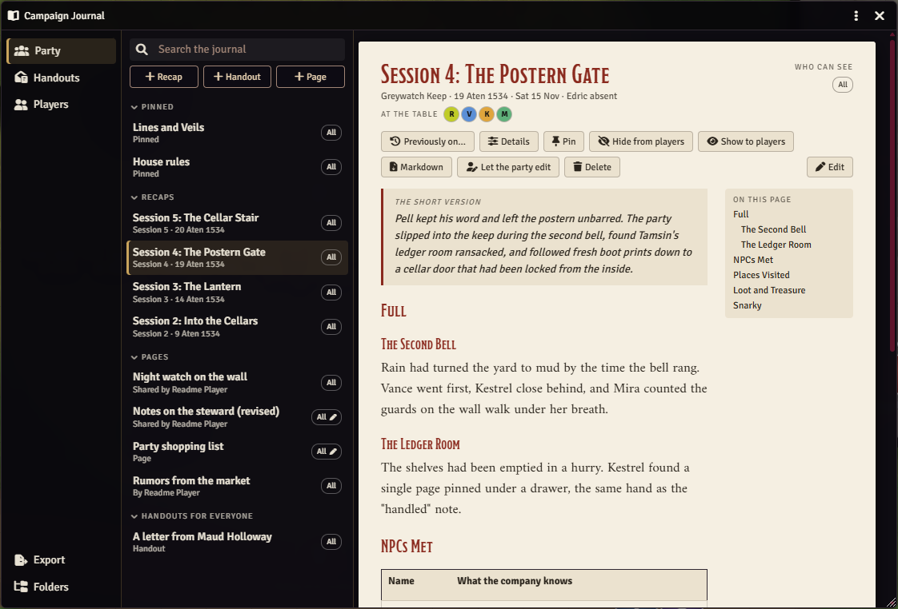
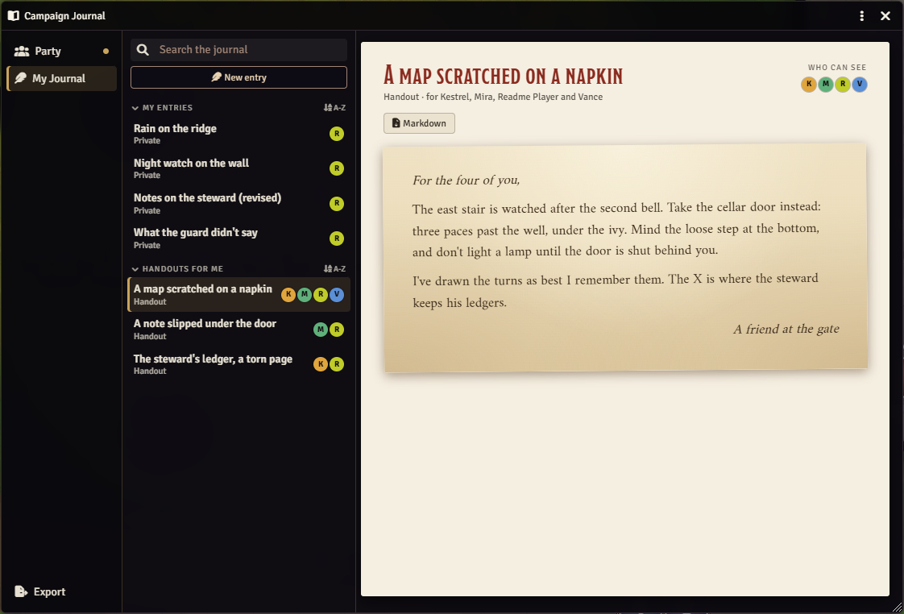
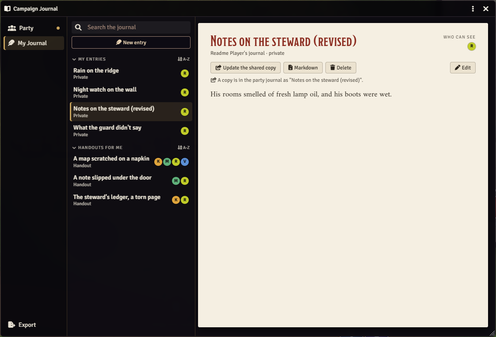
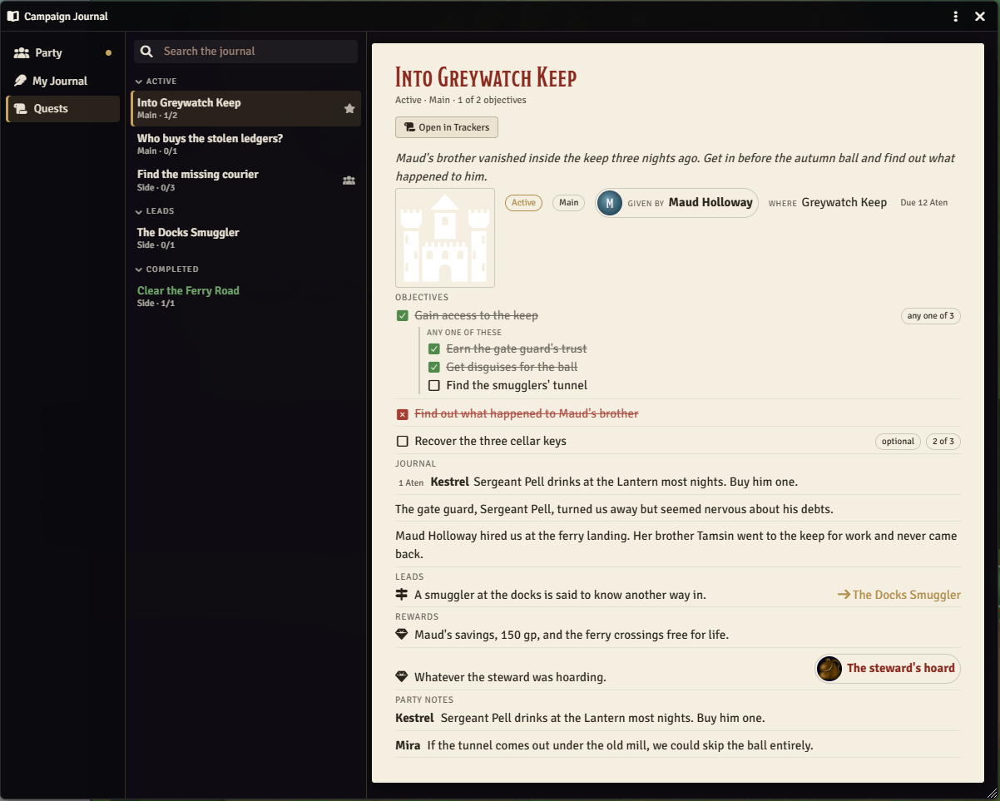
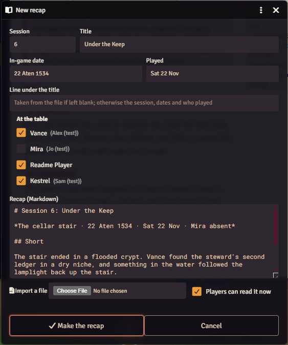
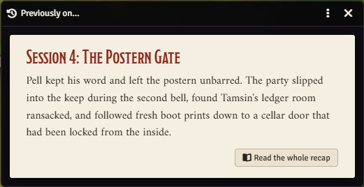

# Bayard's Campaign Journal

A journal window for the party, for Foundry VTT 14 and any game system: session recaps and standing pages, handouts for one player or several, and each player's private journal, with search, New and Updated marks and Markdown export. With PF2e Campaign Trackers installed, the party's quests are there too.

Everything is an ordinary Foundry journal entry in a "Campaign Journal" folder, so nothing is lost if the module is turned off.

## What it looks like



**The party journal.** A session recap with its short version in a box, who was at the table, and a table of contents from its headings. Pinned entries lead the list; the dots show who can see each entry.



**A handout.** Handouts show on parchment: a letter, a blank page or a picture. A player sees only the handouts given to them.



**A player's journal.** Private to the player and the GM. A player can share a copy to the party journal, and the copy stays theirs to edit.



**The Quests tab.** With PF2e Campaign Trackers installed, the party's quests by status, read in the journal as the players see them.



**A new recap.** Paste or import a Markdown recap; the session, title, dates and who was absent fill themselves in.



**"Previously on…".** A recap's short version on the players' screens (and the GM's), with a button to read the rest.

## Install

In Foundry, go to **Add-on Modules**, then **Install Module**, and paste this into **Manifest URL**:

```
https://github.com/Sir-Bayard/bayards-campaign-journal/releases/latest/download/module.json
```

Foundry's **Update** button then picks up each new release. You can also download `module.zip` from the [latest release](https://github.com/Sir-Bayard/bayards-campaign-journal/releases/latest) and unzip it into `Data/modules/bayards-campaign-journal`.

Requires Foundry VTT 14 (verified on 14.370). It works with any game system.

**Before your first session:** give players Foundry's **Create New Journal Entries** permission (in **Configure Permissions**). With it, players write their journals and party entries with no GM logged in; without it, a GM must be logged in for them to.

## Opening it

Click **Campaign Journal** at the top of the Journal tab, or press **J**. Other modules may also use J; change it in **Configure Controls**. The button shows how many entries are new or updated for you, and a player logging in gets one notice when something arrived while they were away. The window remembers its size and place, per world and user.

The whole window works from the keyboard: Tab moves between the tabs, the list and the buttons, and Enter or Space works whatever has focus.

## Where things live

When a GM first logs in with the module on, it makes a **Campaign Journal** folder in the Journal tab with three folders inside:

- **Party**: the party journal. Recaps, standing pages, players' party entries and shared copies. A folder you make inside Party (an arc, say) shows as a group of its own.
- **Handouts**: one entry per handout. Who has a handout is simply who can see it.
- **Players**: a folder for each player, holding their journal. Players who join later get one too.

The module finds these folders by a mark it puts on them, not by their names, so you can rename them. Entries you move into them by hand join the journal. Players don't see the folder in their Journal tab (they read everything in the window); the setting "Players see the journal's folder" shows it again.

## The window

- **Tabs.** Players see **Party** and **My Journal**. The GM sees **Party**, **Handouts** and **Players** (every player's journal and the handouts only some players have). With PF2e Campaign Trackers, everyone also has **Quests**.
- **Who can see.** The dots beside an entry are the players who can read it; **All** means every player, including players who join later, and a small pen means the party can edit it. **GM** means only GMs can.
- **Fold** any group by clicking its heading. Folded groups show a count and stay folded.
- **Search** looks through titles and page text. Where an entry's text matched, a line under it shows where, and the words are marked on the page.
- **New and Updated** marks show what you haven't opened since it arrived or changed, with a dot on the tab. They follow you to any browser. The GM gets them too, for what players write. A player gets a notice when something new reaches them; your own changes never mark anything.
- **On this page** lists a long page's headings; click one to jump to it. **Previous session** and **Next session** step through recaps.
- **Write here** writes in a one-page entry without leaving the journal; **Done** saves (so does moving to another entry, making a new one or closing the window). **Edit** opens Foundry's own editor.
- **Markdown** downloads an entry; **Export** at the bottom of the tabs downloads the whole tab. Links in the text come out as their names, and pictures as image links.

## For the GM

The buttons over the list make new entries: **+ Recap**, **+ Handout** and **+ Page**. Each asks for a title and won't close without one.

**Recaps.** Paste a recap or import a Markdown file. A recap laid out like this fills the form in:

```markdown
# Session 4: The Postern Gate

*Greywatch Keep · 19 March 1200 · Sat 15 Nov · Edric absent*

## Short

The party talked its way past the gate and found the cellar stair.

## Full

...
```

The heading gives the session number and title; the italic line gives the in-game date (read with the world's calendar), the real date, and anyone marked absent. The **Short** section becomes the short version, in a box at the top. Left empty, a recap starts from a template. **"Previously on…"** shows a recap's short version on the screens of the players who can read it, and on yours.

**Handouts** start from a letter, a blank page or a picture, for everyone or for players you choose. A handout for everyone shows on the Party tab; one for some players shows on their My Journal tab.

**Pages** are standing pages in the party journal, such as house rules or a lines and veils list.

Beside **Previously on…**, **Show to players** (opens the entry on the screens of the players who can read it) and **Edit**, the **More** menu holds the rest:

- **Details**: a recap's session, dates and who was there.
- **Give to…**: who has a handout.
- **Pin** keeps anything on the Party tab at the top; **Move up** and **Move down** (or dragging) put pins in order.
- **Hide from players** and **Let players read it**.
- **Let the party edit**: every player can edit a party page and add to it.
- **Markdown**.

**Export** asks for the players' copy or the GM copy. A tab's players' copy holds only what every player can read, so it's safe to post for the table; an entry's holds what its readers see. Both leave hidden secret blocks out. The GM copy has everything, with each secret block marked. On the Players tab, Export gives the GM copy, since players' journals are private.

Foundry's secret blocks work as usual: players see only the ones you've revealed, in the window, search and their downloads.

## For players

**My Journal** holds your own entries, which only you and the GM can read, and the handouts given to you. Each list has a toggle showing its order (newest first, or A to Z, which ignores a leading "A", "An" or "The"); click it to swap.

- **New entry** makes an entry. **Write here** writes in it in the window.
- **Share a copy to the Party Journal** puts a copy in the party journal, signed with your name. Everyone can read it, you can still edit the copy, and your own entry stays private. Sharing again replaces the copy, after asking.
- **New party entry** (on the Party tab) writes straight into the party journal, signed with your name.
- **Let the party edit** (under More) on your party entry or shared copy lets every player edit it; you can stop it again. Changing it needs a GM logged in, since Foundry lets only GMs change permissions.
- **Delete** removes your own entries, shared copies and party entries.

## Quests

With [PF2e Campaign Trackers](https://github.com/Sir-Bayard/pf2e-campaign-trackers) installed (and opened to players), a **Quests** tab lists the party's quests by status, drawn by Trackers as the players see them; **Open in Trackers** opens one there. **Copy link** (or dragging a quest into a page) gives a `@Quest[id]` link that opens the quest. Nothing in this module needs Trackers.

## Privacy

"Private" here means the window and Foundry's own permissions keep an entry out of other players' view. As with everything in Foundry, every journal entry reaches every player's browser, so a player who opens the browser console can read any of them. Don't keep real secrets in a journal.

## Settings

- **Players see the journal's folder** (world, off): shows the Campaign Journal folder in players' Journal tab.
- **Open the Campaign Journal** in **Configure Controls**: the hotkey, J by default.

## Languages

English is included. Every word the module shows is in `lang/en.json`; a translation is a copy of that file in another language, added to `module.json`. Recaps imported from Markdown are read in the layout shown above, in English.

## API

`game.modules.get("bayards-campaign-journal").api`:

- `open(entryId)`: opens the window, on an entry if one is given. Returns a promise of the window.

## Changes

See [CHANGELOG.md](CHANGELOG.md).

## How it was made

This module was written with Claude, Anthropic's AI assistant, directed and tested by its author at a real table. It is shared as is, for free.

## Problems and suggestions

Open an [issue](https://github.com/Sir-Bayard/bayards-campaign-journal/issues).

## License

[MIT](LICENSE). Copyright (c) 2026 Sir Bayard.
